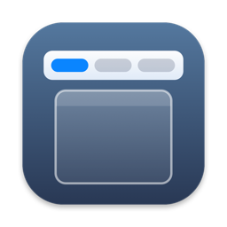
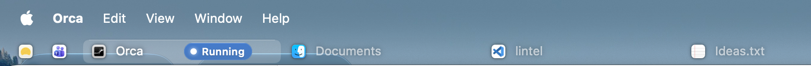

<div align="center">
  
  <h1>Lintel</h1>
  <p>A tab for every window, right under the menu bar.</p>
</div>



Lintel adds a slim, transparent tab bar below the macOS menu bar, one tab per open window. Click a tab to bring that window forward, without the Dock or ⌘Tab. It stays out of the way: no Dock icon, no animations.

## Install

```sh
curl -fsSL https://github.com/gaetandrn/lintel/releases/latest/download/install.sh | bash
```

The installer downloads the latest release, asks a few questions on first install (open at login, how to keep windows below the bar…) and launches Lintel. Run the same command again to update; your settings are kept. To skip the questions, end the command with `bash -s -- --yes`; `bash -s -- --help` lists every option.

Then allow Lintel in **System Settings › Privacy & Security › Accessibility**. The bar appears right away.

Requires macOS 14 or later (call detection needs 14.2), on Apple silicon or Intel.

> [!NOTE]
> Lintel is free and not notarized by Apple. The command above installs it without warnings. If you download `Lintel.zip` from the [releases](https://github.com/gaetandrn/lintel/releases) page instead, macOS blocks the first launch: open **System Settings › Privacy & Security** and click **Open Anyway**.

## Features

- One tab per window, on every display, in the order you choose (drag to reorder).
- Click to switch, middle-click or hover × to close. Closing an app’s last window quits the app, except Finder.
- Pin apps you keep open: they shrink to an icon at the start of the bar.
- Red badges from the Dock (unread messages) appear on the app’s tab.
- Calls in Teams, Zoom or Google Meet are flagged on the call window.
- [Claude Code](https://claude.com/claude-code) sessions show whether they are running, need you, or are done (optional, set up by the installer).
- Hidden in full-screen apps. Text follows the menu bar: dark on a light wallpaper, light on a dark one.
- English and French.
- Checks for updates only when you ask.

## Keeping windows below the bar

macOS has no way to reserve screen space for a bar, so Lintel handles it itself:

- **Double-click a title bar** and the window fills the space below the bar; double-click again to restore it. Turn it on in the installer or with **Double-Click Title Bar to Fill** in the bar’s menu. While it is on, macOS’s own double-click action is set to None; Lintel puts it back when it quits.
- **Rectangle users**: the installer sets Rectangle’s top gap to the bar’s height, so its maximize actions leave room, and lets Rectangle handle title-bar double-clicks.
- **Anything else** (an app that opens maximized, the Window › Fill menu) is moved below the bar right after (**Keep Windows Below the Bar**, on by default).

## Permissions and privacy

Lintel needs the **Accessibility** permission to list windows, read their titles and bring them forward. It reads Dock badges the same way, and asks CoreAudio which apps are using the microphone to spot calls (it never accesses the microphone itself).

Nothing leaves your Mac: no network access except when you click **Check for Updates…**, no analytics.

macOS forgets the Accessibility permission when an app’s signature changes. So that updates keep it, the installer creates a code-signing certificate, **Lintel Local**, in a keychain of Lintel’s own in `~/Library/Application Support/Lintel`, and signs each update with it. Nothing asks for your password: the keychain’s password is stored beside it. The certificate never leaves your Mac; the uninstaller removes it.

If you turn on Claude Code session states, the installer adds hooks to `~/.claude/settings.json`, after copying it to `settings.json.lintel-backup`. They write each session’s state to `~/Library/Application Support/Lintel/agents`; the uninstaller removes them.

## Usage

| Gesture | What it does |
|---|---|
| Click a tab | Bring the window forward |
| Drag a tab | Reorder; pinned icons reorder among themselves |
| Middle-click, or hover and click × | Close the window |
| Click **+N** at the end of the bar | List the windows that don’t fit |
| Right-click a tab | Close the window, quit the app, pin or unpin it |
| Click Lintel’s menu bar icon, or right-click the bar | Open at Login, Keep Windows Below the Bar, Double-Click Title Bar to Fill, Text Color, Check for Updates…, Quit Lintel |
| Hover a Claude Code label (Running, Needs you, Done) | List the sessions and how long they’ve been in that state |

## Troubleshooting

**The bar doesn’t appear after an update.**
macOS ties the permission to the app’s signature. The install command signs every update with the same certificate, so this happens after a manual download of `Lintel.zip`, or when the installer had to create a new certificate (it then says so). In **System Settings › Privacy & Security › Accessibility**, remove Lintel with the − button, open Lintel, and allow it again.

**A window still covers the bar.**
Right-click the bar and make sure **Keep Windows Below the Bar** is checked. Window managers other than Rectangle need a top gap of 28 pt.

**Text is hard to read on my wallpaper.**
Right-click the bar › **Text Color** › **Light** or **Dark**. **Automatic** follows the menu bar, which macOS reports through Lintel’s menu bar icon: if you hide that icon, choose Light or Dark.

## Uninstall

```sh
curl -fsSL https://github.com/gaetandrn/lintel/releases/latest/download/uninstall.sh | bash
```

Removes the app, its settings and permissions, the **Lintel Local** certificate and the Claude Code hooks, and puts back the title-bar, Dock and Rectangle settings that Lintel changed.

## Build from source

```sh
git clone https://github.com/gaetandrn/lintel.git
cd lintel
./install.sh --from-source
```

Needs the Xcode Command Line Tools. See [CONTRIBUTING.md](CONTRIBUTING.md).

## License

[GPL-3.0](LICENSE) © 2026 Gaëtan Didderen
